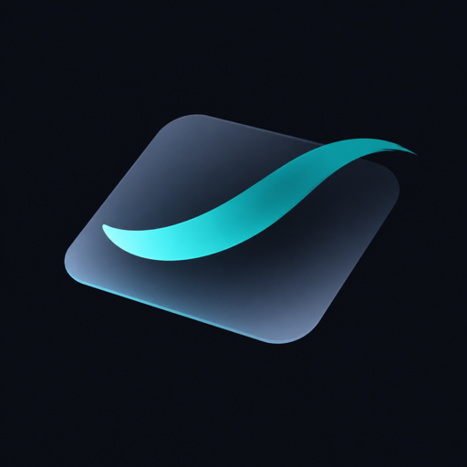
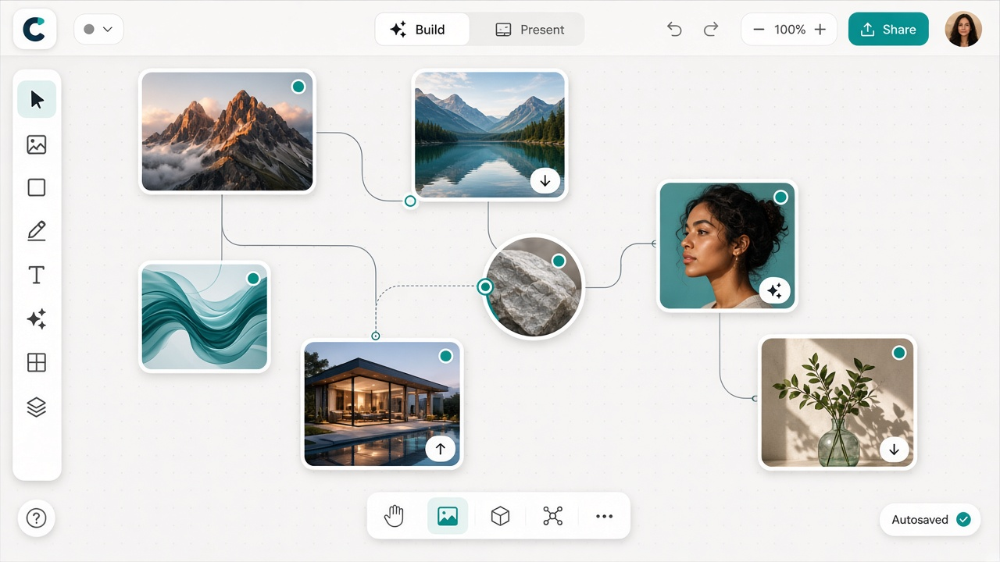
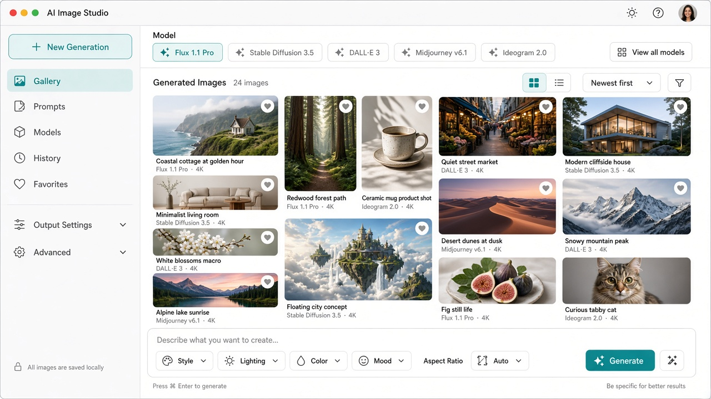
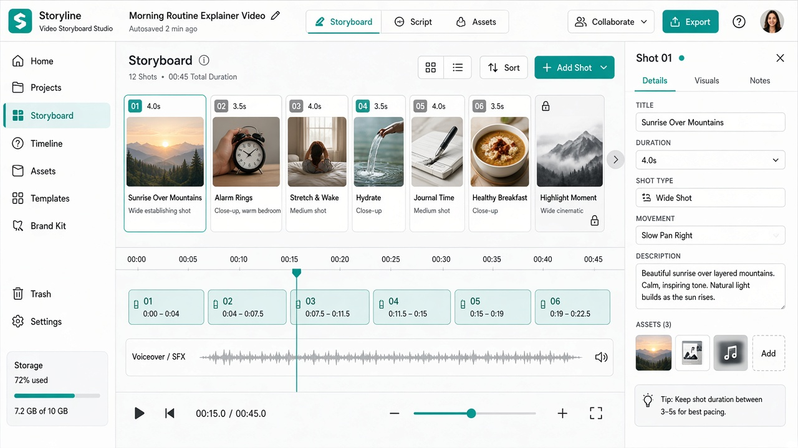
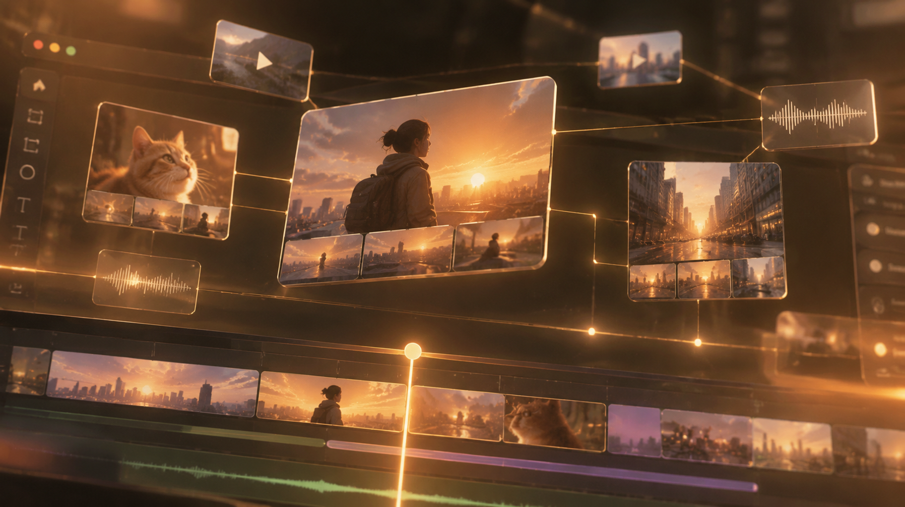

<p align="center">
  
</p>

<h1 align="center">Minimalist Canvas</h1>
<p align="center"><strong>至简画布</strong></p>

<p align="center">
  <a href="./README.md">English</a> ·
  <a href="./README.zh-CN.md">简体中文</a>
</p>

<p align="center">
  <strong>A local-first AI creative studio — infinite canvas, image / video / voice, and Skills in one desktop app.</strong>
</p>

<p align="center">
  Wire prompts, references, and generations into a continuous storyboard.<br />
  Bring your own model channels. Keep data on your machine. Export with optional burn-in watermarks.<br />
  Built for creators who want flow without giving up control.
</p>

<p align="center">
  <a href="https://github.com/LingByte/Minimalist-Canvas/releases"></a>
  <a href="#license"></a>
  
  
  
</p>

---

## Why Minimalist Canvas?

Most AI creative tools either lock you into a single cloud workflow, or scatter image, video, and voice across separate tabs with no shared context. Prompts get lost, references stay disconnected, and exports rarely feel like *your* product.

**Minimalist Canvas** puts the full loop on one local-first desktop:

- **One studio, not five apps**: Infinite canvas + image / video workbenches + voice synthesis + prompt / asset libraries.
- **Your channels, your rules**: Configure OpenAI-compatible providers, TTS engines, and cloud storage yourself — keys stay on device.
- **From idea to finished frames**: Nodes, references, Skills, and generation logs keep the creative trail intact.
- **Lightweight desktop core**: Tauri 2 + React 19 — fast to launch, local-first by design, with optional cloud sync when you want it.

---

## Key Features

### 1. Infinite Canvas Storyboard
Compose prompts, images, video, and audio as nodes on an infinite canvas. Connect references, iterate in place, and keep a spatial memory of the whole piece — not just the last generation.

### 2. Image & Video Workbenches
Dedicated studios for generation and iteration: model picking, size / quality / duration controls, batch results, and one-click save to assets or references. Hover download when watermarking is enabled to choose **with / without watermark**.

### 3. Voice Synthesis Engines
Register speech vendors once, pick voices from a built-in library, and use them across the studio. Credentials and defaults live in Settings — no re-wiring per session.

### 4. Agent, Skills & Prompt Library
Ship with bundled Skills, load local ones, and reuse prompts that already worked. Agent tools can drive canvas and workbench actions so automation stays inside the same creative space.

### 5. Assets, Logs & Usage
Keep generated media in a local asset library, review generation history, and track usage — so good results are easy to find again and costs stay visible.

### 6. Cloud Storage (Optional)
Point the app at your own S3-compatible bucket for public media URLs when models need remote fetch. Local-first remains the default; cloud is opt-in.

### 7. Export Watermark (Local)
Configure text / logo watermarks in Settings with live preview — font, size, placement, opacity, rotation. Burn-in happens only on download, on this device.

### 8. Auto-update Desktop Builds
Desktop builds check GitHub Releases for updates and can download / relaunch in-app. See [docs/AUTO_UPDATE.md](./docs/AUTO_UPDATE.md) and [docs/RELEASE.md](./docs/RELEASE.md).

---

## Product Tour

<p align="center">
  
</p>

<p align="center">
  
</p>

<p align="center">
  
</p>

<p align="center">
  
</p>

---

## Platform Overview

| Dimension | Scattered AI web apps | Single cloud studio | Minimalist Canvas |
| :--- | :--- | :--- | :--- |
| **Workspace** | Separate tabs / tools | Fixed cloud layout | **Infinite canvas + image / video / voice studios** |
| **Models** | Vendor lock-in | Closed catalog | **Bring your own channels & TTS engines** |
| **Data** | Uploaded by default | Vendor-hosted | **Local-first; optional self-hosted cloud storage** |
| **Export** | Generic downloads | Brand watermarks you cannot control | **Optional local burn-in watermark with preview** |
| **Automation** | Copy-paste between tools | Closed workflows | **Agent + Skills inside the same studio** |
| **Runtime** | Browser only | Account-bound web / app | **Tauri desktop (recommended) + web preview** |

---

## Quick Start

### 1. Desktop App (Recommended)

Download installers from [GitHub Releases](https://github.com/LingByte/Minimalist-Canvas/releases):

- **macOS**: `.dmg` / `.app`
- **Windows**: NSIS `.exe`

> macOS builds may be ad-hoc signed. If Gatekeeper blocks first launch: **System Settings → Privacy & Security → Open Anyway**, or run:
>
> ```bash
> xattr -d com.apple.quarantine "/Applications/Minimalist Canvas.app"
> ```

### 2. Local Development

Prerequisites: [Bun](https://bun.sh/), [Rust](https://rustup.rs/) stable, and on macOS Xcode Command Line Tools.

```bash
bun install

# Web preview
bun run dev

# Desktop (recommended)
bun run tauri:dev

# Production desktop build (DMG / NSIS + updater artifacts)
bun run tauri:build
```

| Command | Purpose |
| --- | --- |
| `bun run dev` | Rsbuild web preview |
| `bun run tauri:dev` | Tauri desktop hot reload |
| `bun run tauri:build` | Production installers |
| `bun run typecheck` | TypeScript check |
| `bun run lint` | oxlint |

Version source of truth: `package.json` / `src-tauri/tauri.conf.json`.

Build artifacts typically land under:

```text
src-tauri/target/release/bundle/dmg/
src-tauri/target/release/bundle/nsis/
```

---

## Tech Stack

| Layer | Stack |
| --- | --- |
| Frontend | React 19, TypeScript, Rsbuild, Ant Design, Tailwind |
| Desktop | Tauri 2 (Rust) |
| State | Zustand, TanStack Query |
| i18n | i18next (en / zh / zh-TW / fr / ja / ru / vi) |

---

## Official Links

- **Repository**: [github.com/LingByte/Minimalist-Canvas](https://github.com/LingByte/Minimalist-Canvas)
- **Releases**: [github.com/LingByte/Minimalist-Canvas/releases](https://github.com/LingByte/Minimalist-Canvas/releases)
- **Auto-update notes**: [docs/AUTO_UPDATE.md](./docs/AUTO_UPDATE.md)
- **Release guide**: [docs/RELEASE.md](./docs/RELEASE.md)

---

## License

MIT
