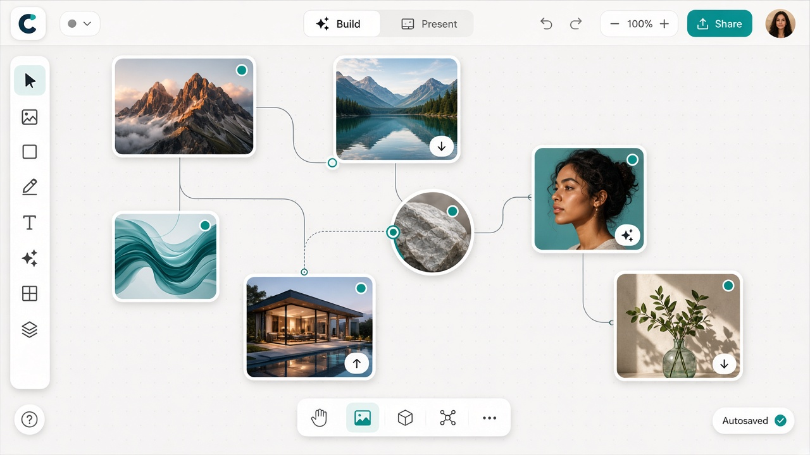
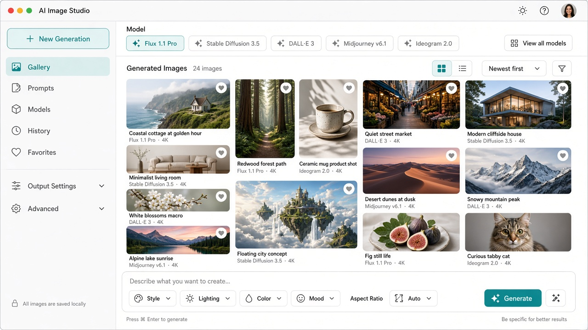
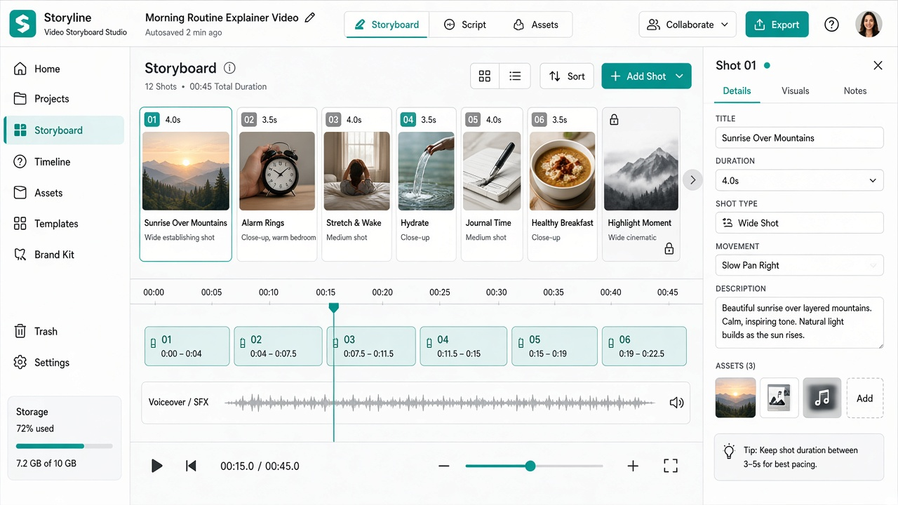

<p align="center">
  
</p>

<h1 align="center">至简画布</h1>
<p align="center"><strong>Minimalist Canvas</strong></p>

<p align="center">
  <a href="./README.md">English</a> ·
  <a href="./README.zh-CN.md">简体中文</a>
</p>

<p align="center">
  <strong>本地优先的 AI 创作工作室 — 无限画布、图像 / 视频 / 语音与 Skills，装在同一个桌面端里。</strong>
</p>

<p align="center">
  把提示词、参考素材和生成结果串成连续的故事板。<br />
  渠道自己配，数据留在本机，下载时可按需烧录水印。<br />
  为既要流畅创作、又要掌控权的人而做。
</p>

<p align="center">
  <a href="https://github.com/LingByte/Minimalist-Canvas/releases"></a>
  <a href="#license"></a>
  
  
  
</p>

---

## 为什么是至简画布？

多数 AI 创作工具要么把你锁进单一云端流程，要么把生图、视频、语音拆成互不相关的页面。提示词散落各处，参考图对不上结果，导出也不像「自己的产品」。

**至简画布**把整条链路收进一个本地优先的桌面端：

- **一个工作室，而不是五个网页**：无限画布 + 图像 / 视频创作台 + 语音合成 + 提示词 / 素材库。
- **渠道随你，规则随你**：自行配置 OpenAI 兼容渠道、语音合成引擎与云端存储 — 密钥留在本机。
- **从想法推到成片**：节点、参考、Skills 与生成记录让创作轨迹可回看。
- **轻量桌面内核**：Tauri 2 + React 19 — 启动快，默认本地，需要时再接云端。

---

## 核心能力

### 1. 无限画布故事板
把提示词、图片、视频与音频作为节点铺在无限画布上。串联参考、原地迭代，空间里留下整部作品的记忆 — 而不只是最后一次生成。

### 2. 图像与视频创作台
专用工作台负责生成与迭代：模型选择、尺寸 / 清晰度 / 时长、批量结果，以及一键存资产或加参考。启用水印后，悬停「下载」即可选择**带水印 / 不带水印**。

### 3. 语音合成引擎
在设置里注册语音厂商，从内置音色库选用，全工作室共用。凭证与默认项一次配好，不必每次重来。

### 4. Agent、Skills 与提示词库
内置 Skills，也可加载本地技能；把跑得稳的提示词沉淀下来。Agent 工具可驱动画布与工作台动作，让自动化发生在同一创作空间内。

### 5. 资产、记录与用量
生成结果进本机素材库，生成记录可回看，用量可追踪 — 好结果找得到，成本也看得见。

### 6. 云端存储（可选）
按需接入自有的 S3 兼容存储，给模型提供可公网拉取的媒体外链。默认仍是本地优先，云端是可选项。

### 7. 导出水印（本机）
在设置中配置文字 / Logo 水印，并有实时预览 — 字体、字号、位置、透明度、旋转。仅在本机下载时烧录。

### 8. 桌面端自动更新
桌面构建会检查 GitHub Releases，并可在应用内下载、重启安装。详见 [docs/AUTO_UPDATE.md](./docs/AUTO_UPDATE.md) 与 [docs/RELEASE.md](./docs/RELEASE.md)。

---

## 产品掠影

<p align="center">
  
</p>

<p align="center">
  
</p>

<p align="center">
  
</p>

<p align="center">
  
</p>

---

## 能力对照

| 维度 | 分散的 AI 网页工具 | 单一云端工作室 | 至简画布 |
| :--- | :--- | :--- | :--- |
| **工作区** | 多个标签页 / 工具 | 固定云端布局 | **无限画布 + 图像 / 视频 / 语音创作台** |
| **模型** | 厂商锁定 | 封闭目录 | **自带渠道与语音合成引擎** |
| **数据** | 默认上传 | 厂商托管 | **本地优先；可选自建云端存储** |
| **导出** | 通用下载 | 无法掌控的品牌水印 | **可选本机烧录水印，带预览** |
| **自动化** | 工具间复制粘贴 | 封闭工作流 | **同一工作室内的 Agent + Skills** |
| **运行时** | 仅浏览器 | 账号绑定的网页 / App | **Tauri 桌面端（推荐）+ 网页预览** |

---

## 快速开始

### 1. 桌面端（推荐）

从 [GitHub Releases](https://github.com/LingByte/Minimalist-Canvas/releases) 下载安装包：

- **macOS**：`.dmg` / `.app`
- **Windows**：NSIS `.exe`

> macOS 构建可能是 ad-hoc 签名。若首次打开被拦截：系统设置 → 隐私与安全性 → 仍要打开，或执行：
>
> ```bash
> xattr -d com.apple.quarantine "/Applications/Minimalist Canvas.app"
> ```

### 2. 本地开发

依赖：[Bun](https://bun.sh/)、[Rust](https://rustup.rs/) stable；macOS 还需 Xcode Command Line Tools。

```bash
bun install

# 网页预览
bun run dev

# 桌面端（推荐）
bun run tauri:dev

# 生产构建（DMG / NSIS + 更新产物）
bun run tauri:build
```

| 命令 | 用途 |
| --- | --- |
| `bun run dev` | Rsbuild 网页预览 |
| `bun run tauri:dev` | Tauri 桌面热更新 |
| `bun run tauri:build` | 生产安装包 |
| `bun run typecheck` | TypeScript 检查 |
| `bun run lint` | oxlint |

版本以 `package.json` / `src-tauri/tauri.conf.json` 为准。

构建产物大致在：

```text
src-tauri/target/release/bundle/dmg/
src-tauri/target/release/bundle/nsis/
```

---

## 技术栈

| 层级 | 技术 |
| --- | --- |
| 前端 | React 19, TypeScript, Rsbuild, Ant Design, Tailwind |
| 桌面 | Tauri 2 (Rust) |
| 状态 | Zustand, TanStack Query |
| 国际化 | i18next（en / zh / zh-TW / fr / ja / ru / vi） |

---

## 相关链接

- **仓库**：[github.com/LingByte/Minimalist-Canvas](https://github.com/LingByte/Minimalist-Canvas)
- **发布页**：[github.com/LingByte/Minimalist-Canvas/releases](https://github.com/LingByte/Minimalist-Canvas/releases)
- **自动更新说明**：[docs/AUTO_UPDATE.md](./docs/AUTO_UPDATE.md)
- **发版指南**：[docs/RELEASE.md](./docs/RELEASE.md)

---

## License

MIT
